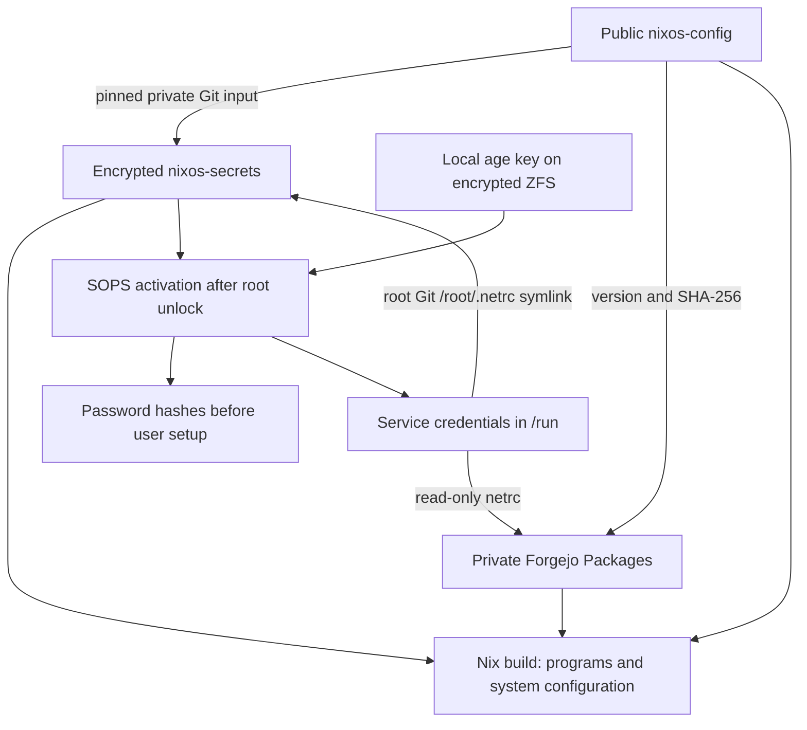

# Configuration, encrypted secrets and private artifacts

There are two Git repositories and one package registry:

| Location | Contents | Access |
| --- | --- | --- |
| [nixos-config](https://fgj.okhsunrog.dev/okhsunrog/nixos-config) | Nix modules, package recipes, version/hash pins, public trust certificates | Public |
| [nixos-secrets](https://fgj.okhsunrog.dev/okhsunrog/nixos-secrets) | SOPS ciphertext, public age recipient and recovery instructions | Private Git repository |
| [private-artifacts](https://fgj.okhsunrog.dev/private-artifacts/-/packages) | NAC, Fleet/Orbit and VKey installation archives without enrollment secrets | Private organization Packages |
| `/var/lib/sops-nix/key.txt` | The private age decryption key | Laptop only, root-owned mode `000`, parent `0700`; independent password-manager backup |



## Runtime and recovery keys

`framework.enc.json` holds password hashes, a Forgejo read token, the Orbit
environment and a signing-key recovery section. The age private key is never
committed, copied into a derivation, or included in initramfs. Mode `000` does
not prevent privileged root from reading it; it is not an additional boundary
against an unconfined root service. ZFS protects it while the pool is locked.

On boot, the existing loader/ZFS mechanism unlocks root first. sops-nix then
decrypts password hashes before user setup, and regular secrets into a private
ramfs under `/run` (RAM without swap). Root's `/root/.netrc` is a symlink to that secret so Git
and Nix can authenticate without tokens in URLs, Nix expressions or `.drv`
files. `nix-daemon` is ordered after secret provisioning. The token has
`read:package` and `read:repository`; it cannot upload packages or push commits.
These scopes cover resources the owning account can read, not just one package.

Secure Boot db/PK/KEK, IMA and PCR private keys, their corresponding certificates
and the sbctl GUID are backed up **encrypted** in the private repository. They
are not automatically decrypted on every boot. Working signing files remain
root-only in `/var/lib/secureboot` and `/var/lib/sbctl`; this also preserves
offline generation publication from Arch. The public trust certificates in
`hosts/framework/public` can be published; they cannot create signatures.

The age key has an independent backup in the owner's password manager. Losing
both that copy and the laptop key makes the SOPS data unrecoverable. A private
repository on a home NAS is not a substitute for an independent backup. Never
store the age private key alongside its ciphertext in Git.

## Initial deployment and rebuilding from Arch

Restore the age key privately to `ROOT/var/lib/sops-nix/key.txt`, root-owned mode
`000`, with a `0700` parent. Obtain both Git repositories using existing Git
credentials or an authorized SSH key. Authentication to the private repository
is needed once before its encrypted contents can be decrypted; the age key
itself is not a Forgejo login credential.

With NixOS mounted at `/mnt/nixos` and both repositories under `~/code`:

```sh
# Run from nixos-config. The package shell supplies sops; it does not load keys.
nix shell .#sops
sudo --preserve-env=PATH scripts/with-forgejo.sh /mnt/nixos \
  ../nixos-secrets/framework.enc.json \
  build .#nixosConfigurations.framework.config.system.build.toplevel \
  --out-link result-framework
```

`with-forgejo.sh` decrypts only the read credential into a root-only temporary
directory in `/run`, preserves the normal persistent cache location, runs Nix
with authenticated Git/HTTP access and removes the credential on exit. Supply
sops on root's PATH if sudo resets the package-shell PATH. Never put a token in
an argument, an environment variable recorded in a derivation, or `flake.lock`.

After normal NixOS boot, run `./scripts/rebuild-framework.sh` as the regular user.
It prepares the matching signed modules before installing a boot generation;
sudo is used only for runtime signing and installation. The installed Nix daemon
uses the runtime netrc without the bootstrap wrapper. Both private Git input
revision and package hashes are pinned. Updating secrets means committing and
pushing `nixos-secrets`, then `nix flake update host-secrets` in `nixos-config`.
Floppa's non-secret deployment JSON is a separate `flake = false` file input,
`floppa-deployment`, pinned by its NAR hash in `flake.lock`. Reading it during
configuration evaluation does not build or fetch a derivation. Its contents stay
in the private registry and the local store; the public configuration contains
only its URL and hash. `host-secrets` remains ciphertext-only.

File-input fetching uses the evaluating process's HTTP credentials. When adding
or changing this private input, use root's existing runtime netrc to produce a
lockfile, then copy that public lockfile back as the repository owner:

```sh
sudo nix flake update floppa-deployment --output-lock-file /var/lib/zbm-rs-public/framework-inputs.lock
cp /var/lib/zbm-rs-public/framework-inputs.lock flake.lock
```

Normal builds use the pinned store input; no token is copied into the repository.
On a fresh machine, authenticated input prefetch is required before an offline
build, just as the private Git input must already be available.

Updating a binary means publishing a new package version and updating
`packages/artifacts.json`, never silently replacing an existing pinned version.

Explicit signing-key recovery, after restoring the age key:

```sh
sudo --preserve-env=PATH scripts/restore-signing-keys.sh /mnt/nixos \
  ../nixos-secrets/framework.enc.json
```

The helper restores missing signing files and checks matching existing files;
it refuses to overwrite a different key. It never changes firmware enrollment,
TPM state, ZFS encryption, EFI entries or the active boot environment.

## Binary contents and mutable state

The original Fleet DEB contains `ORBIT_ENROLL_SECRET`. The registry's
`fleet-orbit` runtime archive contains only `opt/orbit` binaries and support
files. Its enrollment environment is supplied through SOPS. Deleting the
environment during a package install would not suffice: the original DEB would
still be a readable Nix store input. Private registry authentication protects
downloads, but installed binaries are locally readable in the Nix store.

The package recipes are available as `.#nac-agent`, `.#fleet-orbit`,
`.#vkey-client` and `.#vkey-runtime`. Building a package does not execute a vendor
installer or enroll the laptop. The Framework host explicitly enables the
[corporate workstation module](corporate-workstation.md): confined services,
D-Bus filtering, audit, script archival, split DNS and VKey user integration.
Existing enrollment and TPM state are imported separately outside the Nix store.

Orbit updater state, NAC registration and the TPM PKCS#11 database are mutable
state and need separate backups. ZFS pool unlock material and TPM-sealed
objects are not replaced by this secret repository. Arctern home snapshots
cover user data; verify separate coverage for these root-owned state paths.
Home Manager is intentionally not introduced during this migration.
